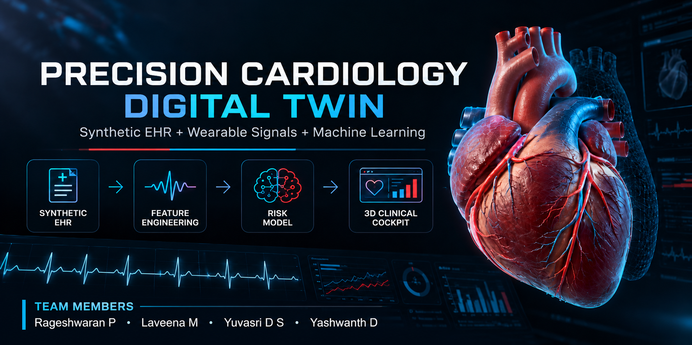

<div align="center">

# Precision Cardiology Digital Twin

### AI-Powered Cardiac Monitoring Research Prototype



**Synthetic EHR · Wearable Signals · Machine Learning · Interactive 3D Heart**

[](https://www.python.org/)
[](https://streamlit.io/)
[](https://scikit-learn.org/)
[](https://threejs.org/)
[](https://www.docker.com/)

**[View Source Code](https://github.com/Rageshwaran13/precision-cardiology-digital-twin)**
  ·  
**[Watch Working Demo](https://youtu.be/QsqEUqtMn5g)**

</div>

---

> **Medical disclaimer:** This is a research and hackathon proof-of-concept using synthetic patient data. It has not been clinically validated and must not be used for medical diagnosis, treatment, emergency response, or real-world clinical decision-making.

## 1. Project Overview

Precision Cardiology Digital Twin is a healthcare technology research prototype that integrates synthetic electronic health records (EHR), wearable-style physiological time-series data, machine learning, and interactive 3D heart visualization.

The project demonstrates how simulated clinical information and physiological measurements can be processed through a machine-learning pipeline and presented in a unified, interactive dashboard.

The dashboard combines patient summaries, physiological telemetry, model-generated cardiac-anomaly risk estimates, and an interactive 3D heart visualization to demonstrate a digital-twin-inspired cardiac monitoring workflow.

### Key Objectives

* Integrate synthetic patient information with wearable-style physiological signals.
* Explore physiological trends using time-series feature engineering.
* Demonstrate machine-learning-based cardiac-anomaly risk estimation.
* Present model outputs through an interactive dashboard.
* Visualize cardiac anatomy using a 3D heart model.
* Provide a reproducible environment for research and demonstration.

## 2. Problem Statement

Cardiac monitoring involves interpreting clinical information and physiological measurements collected over time. Presenting these different data sources together can help researchers explore patterns and understand how monitoring software might support future decision-making workflows.

The Precision Cardiology Digital Twin project addresses this integration challenge through a research prototype that combines synthetic electronic health records, wearable-style physiological signals, machine-learning analysis, and interactive visualization in a unified dashboard.

The objective is to demonstrate how these data sources can be processed and presented together, allowing users to explore simulated physiological trends and model-generated cardiac-anomaly risk estimates through a single interface.

The project focuses on data integration, predictive modelling, and visualization rather than establishing a clinically validated prediction system.

## 3. Healthcare Use Case

The prototype demonstrates a simulated cardiac-monitoring workflow in which users can:

1. Review a simulated patient's demographic and clinical information.
2. Examine wearable-style physiological measurements and trends.
3. Explore features generated from physiological time-series data.
4. View model-generated cardiac-anomaly risk estimates.
5. Inspect an interactive 3D heart visualization.
6. Explore the relationship between simulated patient information, physiological trends, and model outputs.

The intended purpose is to demonstrate the integration of healthcare data, machine learning, and visualization.

The system has not been clinically validated and must not be used to guide real patient care.

## 4. Key Features

### Synthetic Patient Data

Generates simulated electronic health records and wearable-style physiological time-series data for a controlled demonstration environment.

### Physiological Signal Analysis

Supports exploration of generated physiological measurements, including heart rate, heart-rate variability, oxygen saturation, and sleep-related indicators where implemented.

### Time-Series Feature Engineering

Combines clinical baseline information with physiological measurements and rolling statistical summaries for model training and inference.

### Machine Learning

Uses a gradient-boosting classification pipeline to demonstrate cardiac-anomaly risk estimation on a synthetic dataset.

### Interactive Dashboard

Presents patient information, physiological charts, risk visualization, and supporting clinical-style information through a Streamlit interface.

### 3D Heart Visualization

Integrates a 3D anatomical heart visualization using Three.js and WebGL.

### Reproducible Demonstration

Provides scripts for generating synthetic data, preparing model features, training the model, and launching the dashboard.

### Containerized Execution

Includes Docker and Docker Compose configuration for running the dashboard in a containerized environment.

## 5. Technical Stack

| Component             | Technology                                         |
| --------------------- | -------------------------------------------------- |
| Programming language  | Python                                             |
| Data processing       | Pandas, NumPy                                      |
| Machine learning      | scikit-learn, with XGBoost support where available |
| Interactive dashboard | Streamlit                                          |
| Data visualization    | Plotly                                             |
| 3D rendering          | Three.js, WebGL                                    |
| Data generation       | Python-based synthetic data generation             |
| Containerization      | Docker, Docker Compose                             |
| Version control       | Git, GitHub                                        |

## 6. AI/ML Model Details

The project uses a gradient-boosting classification pipeline to demonstrate cardiac-anomaly risk estimation using synthetic clinical and physiological data.

### Dataset Design

The synthetic demonstration dataset is designed around the following parameters:

* **Simulated patients:** 500
* **Wearable-style monitoring duration:** 30 days per patient
* **Sampling frequency:** Hourly
* **Records per patient:** 720
* **Total wearable-style records:** 360,000
* **Engineered model features:** 33
* **Anomaly simulation:** Synthetic anomaly patterns are introduced into the final 24-hour window for a subset of simulated patients.

These values describe the synthetic data-generation design, not a real clinical cohort.

### Feature Engineering

The feature-engineering pipeline combines clinical baseline information with physiological measurements and six-hour rolling summaries.

Feature groups include:

* Clinical and demographic baseline features.
* Instantaneous wearable-style measurements.
* Rolling physiological statistics.
* Sleep-stage indicators.
* Encoded demographic variables.

### Model Training and Evaluation

The model is trained using the generated synthetic dataset. The training pipeline produces model artifacts locally for use by the dashboard.

Evaluation uses a patient-level split in the synthetic demonstration dataset.

Because the synthetic anomaly patterns are intentionally separable, high performance on this dataset does not establish clinical accuracy or real-world predictive capability.

Before clinical applications could be considered, the system would require appropriately governed clinical datasets, leakage-resistant temporal validation, probability calibration, independent external validation, and clinical review.

## 7. System Architecture

The project follows this conceptual data-processing and visualization pipeline:

```text
┌───────────────────────┐
│  Synthetic EHR Data   │
└───────────┬───────────┘
            │
            ▼
┌───────────────────────┐
│ Wearable-Style Signals│
└───────────┬───────────┘
            │
            ▼
┌───────────────────────┐
│  Data Integration     │
└───────────┬───────────┘
            │
            ▼
┌───────────────────────┐
│ Feature Engineering   │
└───────────┬───────────┘
            │
            ▼
┌───────────────────────┐
│ Gradient-Boosting     │
│ Classification Model  │
└───────────┬───────────┘
            │
            ▼
┌───────────────────────┐
│ Risk Estimate and     │
│ Physiological Trends  │
└───────────┬───────────┘
            │
            ▼
┌───────────────────────┐
│ Streamlit Dashboard   │
│ + Interactive 3D Heart│
└───────────────────────┘
```

This diagram represents the conceptual workflow. It does not establish clinical validity.

For the supporting project documentation, see the architecture/project blueprint and presentation linked below.

## 8. Working Demonstration

<div align="center">

### Precision Cardiology Digital Twin — Project Demo

[](https://youtu.be/QsqEUqtMn5g)

**[Open the Working Demo on YouTube](https://youtu.be/QsqEUqtMn5g)**

</div>

The demonstration video showcases the project's working interface and cardiac-monitoring visualization workflow.

The current recording is a short demonstration. A longer 15–20 minute walkthrough should be added separately to satisfy submission requirements that specify that duration.

## 9. Project Team

| S. No. | Team Member   |
| ------ | ------------- |
| 1      | Rageshwaran P |
| 2      | Laveena M     |
| 3      | Yuvasri D S   |
| 4      | Yashwanth D   |

### College / Incubator Information

* **College / Institution:** [Enter official college name]
* **Department:** [Enter department name]
* **Incubator / Innovation Centre:** [Enter official name or Not Applicable, if permitted]

**Before submission:** Replace these placeholders with the correct institutional information. Do not leave placeholders in the final README.

## 10. Repository Structure

```text
precision-cardiology-digital-twin/
├── .github/
│   └── workflows/
├── dashboard/
│   ├── app.py
│   ├── components/
│   └── static/
├── data/
│   ├── raw/
│   └── processed/
├── docs/
│   ├── precision-cardiology-hero.png
│   ├── Precision_Cardiology_Digital_Twin_Presentation.pptx
│   ├── precision_cardiology_blueprint.pdf
│   ├── GITHUB_UPLOAD.md
│   └── THIRD_PARTY_ASSETS.md
├── models/
├── scripts/
│   └── setup_demo.py
├── src/
│   ├── data/
│   ├── model/
│   └── utils/
├── .dockerignore
├── .gitignore
├── Dockerfile
├── docker-compose.yml
├── requirements.txt
└── README.md
```

Generated datasets and trained model artifacts are created locally and intentionally excluded from version control to keep the repository easier to clone and review.

The setup script regenerates the demonstration data and trains the model.

*Note: The directory diagram documents the intended project layout. Keep it synchronized with the actual files in the repository.*

## 11. Installation and Execution

### Prerequisites

* Python 3.11 recommended.
* Git.
* Sufficient disk space for the generated datasets and model artifacts.
* A Windows, macOS, or Linux environment.

### Step 1: Clone the Repository

```bash
git clone https://github.com/Rageshwaran13/precision-cardiology-digital-twin.git
cd precision-cardiology-digital-twin
```

### Step 2: Create a Virtual Environment

**Windows PowerShell**

```powershell
py -3.11 -m venv .venv
.\.venv\Scripts\Activate.ps1
```

**Windows Command Prompt**

```cmd
py -3.11 -m venv .venv
.venv\Scripts\activate.bat
```

**macOS / Linux**

```bash
python3.11 -m venv .venv
source .venv/bin/activate
```

### Step 3: Install Dependencies

```bash
python -m pip install --upgrade pip
pip install -r requirements.txt
```

### Step 4: Generate Synthetic Data and Train the Model

Run the setup script from the repository root:

```bash
python scripts/setup_demo.py
```

The script runs the data-generation, integration, feature-engineering, and model-training steps configured by the project.

Generated CSV files are stored under `data/`, and trained artifacts are stored under `models/`.

Allow sufficient time and disk space for dataset generation and model training.

### Step 5: Launch the Dashboard

```bash
streamlit run dashboard/app.py
```

Open the local address printed by Streamlit, normally:

```text
http://localhost:8501
```

The application should display the dashboard if the dependencies, generated data, and model artifacts have been prepared successfully.

## 12. Run with Docker

Docker execution requires Docker Desktop or an equivalent Docker installation.

First, complete the data-generation and model-training steps on the host machine:

```bash
python scripts/setup_demo.py
```

Then build and start the container:

```bash
docker compose up --build
```

Open:

```text
http://localhost:8501
```

The Compose configuration mounts the local project directories into the container.

To stop the application:

```bash
docker compose down
```

Container execution should be tested in the target environment before claiming that the deployment has been verified.

## 13. Project Documents

The following documents are intended to support project review and presentation.

* [Project Presentation — PowerPoint](docs/Precision_Cardiology_Digital_Twin_Presentation.pptx)
* [Architecture / Project Blueprint — PDF](docs/precision_cardiology_blueprint.pdf)
* [GitHub Publishing Guide](docs/GITHUB_UPLOAD.md)
* [Third-Party Asset Information](docs/THIRD_PARTY_ASSETS.md)

If a required file is missing, upload it to the `docs/` directory and update its link.

The architecture submission should contain a clear system architecture diagram. If the existing blueprint does not include one, provide a separate architecture diagram in PDF or PPT format.

If the submission requires both presentation formats, provide the presentation as both PPTX and PDF.

## 14. Evaluation and Limitations

This project is a research and hackathon proof-of-concept using synthetic data.

The synthetic data-generation process introduces deliberately separable anomaly patterns. Consequently, model performance on this dataset must not be interpreted as evidence of real-world clinical accuracy.

The project has not been validated for use with real patients.

Before any clinical application could be considered, further work would include:

* Evaluation using appropriately licensed and governed clinical datasets.
* Patient-level and temporal validation designed to prevent information leakage.
* Probability calibration and uncertainty estimation.
* Independent external validation.
* Explainability and robustness assessment.
* Clinical usability testing.
* Privacy and security assessment.
* Applicable regulatory and clinical review.

The system is not a medical device and must not be used to guide patient care.

## 15. Privacy and Data Safety

The demonstration is designed around synthetic patient data.

Do not commit real patient records, personal health information, passwords, API keys, credentials, or other sensitive information to this public repository.

Generated datasets and trained model artifacts should remain excluded from Git unless there is a clear, appropriate reason to publish them and they have been reviewed for privacy, size, and licensing concerns.

## 16. License and Third-Party Assets

A project-wide open-source license should be selected deliberately before inviting others to reuse or contribute to the project.

Before adding a license, confirm that the team has the rights to license the original project code.

Third-party libraries, 3D models, images, and other external assets may have separate licensing and redistribution requirements. A project-wide license does not automatically grant rights to materials the team does not own.

In particular, verify the redistribution permissions for the bundled 3D heart model and heart illustration, and preserve any required third-party notices.

## 17. Future Work

Potential future improvements include:

* Evaluation with appropriately governed real-world clinical datasets.
* Improved temporal validation and leakage prevention.
* Probability calibration and uncertainty reporting.
* More detailed model explanations.
* Expanded physiological visualization.
* Improved usability and accessibility.
* Reproducible deployment and automated testing.
* Clinical, privacy, security, and regulatory assessment where applicable.

## 18. Repository

**GitHub Repository:**
https://github.com/Rageshwaran13/precision-cardiology-digital-twin

---

<div align="center">

**Precision Cardiology Digital Twin**

*Integrating synthetic healthcare data, machine learning, and interactive cardiac visualization.*

**Research Prototype · Synthetic Data · Not for Clinical Use**

</div>
